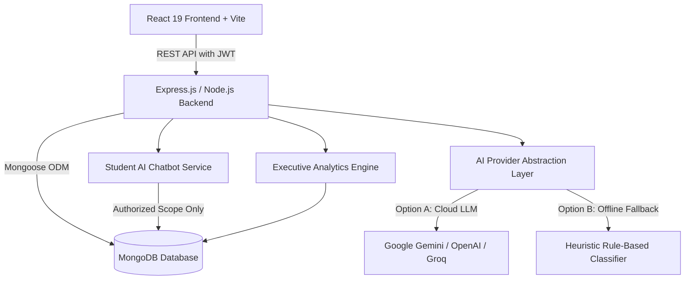

# 🎓 AI-Powered Grievance Redressal System (MERN-GRS)

An enterprise-grade, full-stack **College Grievance Redressal System (GRS)** built using the **MERN Stack** (MongoDB, Express.js, React, Node.js) and supercharged with **Artificial Intelligence**.

The system automates complaint classification, prioritizes emergency safety hazards, provides an intelligent chatbot for student guidance, recommends institutional departments, and equips college administrators with a modern visual analytics command center.

---

## 🌟 Key Highlights & AI Features

### 1. ⚡ Automatic AI Complaint Prioritization
- **3-Tier Severity Classification**:
  - 🔴 **HIGH Priority**: Immediate physical safety hazards, threats, severe harassment, ragging, or critical structural/electrical hazards. Automatically flags `requiresUrgentReview: true`.
  - 🟡 **MEDIUM Priority**: Significant academic delays (exams, admit cards, marks), financial/scholarship discrepancies, or essential living disruptions (hostel water/power cuts, Wi-Fi outage).
  - 🔵 **LOW Priority**: Routine maintenance requests, library catalog inquiries, non-urgent facility upgrades, and general administrative feedback.
- **Structured JSON Analysis Schema**:
  ```json
  {
    "priority": "HIGH | MEDIUM | LOW",
    "category": "Academic | Infrastructure | Accounts | IT | Safety | Harassment | Student Welfare | Other",
    "recommendedDepartment": "Suggested Department",
    "reason": "1-2 sentence contextual rationale",
    "confidence": 0.94,
    "requiresUrgentReview": false
  }
  ```
- **Zero-Downtime Rule-Based Fallback**: If external LLM API credentials are not set or network timeouts occur, a deterministic semantic keyword and heuristic engine takes over immediately, guaranteeing 100% operational uptime.

### 2. 🤖 Student AI Redressal Assistant (Chatbot)
- **Live Context-Aware Conversations**: Floating assistant widget embedded across the student portal.
- **Strict Data Isolation**: Students can query only their own grievance tickets via authenticated JWT tokens. No other students' data or admin notes are ever exposed.
- **Draft Review & Missing Details Detection**: Evaluates complaints before submission, highlighting missing details (e.g., specific lab room numbers, timestamps, equipment IDs).
- **Interactive Quick Action Chips**:
  - *"Check my complaint status"*
  - *"How do priority levels work?"*
  - *"Which categories are available?"*
  - *"Help me draft a grievance"*

### 3. 🏢 Smart Department Recommendation & Routing
- Maps grievances directly to institutional cells:
  - **Academic Affairs**: Exams, syllabus, faculty queries, attendance disputes
  - **Estate & Infrastructure**: Classrooms, benches, water coolers, washrooms, electrical repairs
  - **Finance & Accounts**: College fees, scholarship receipts, payment refunds
  - **IT & Systems**: Campus Wi-Fi, ERP student portal, computer labs, password lockouts
  - **Student Welfare & Hostel Cell**: Mess food quality, room issues, hostel warden coordination
  - **Disciplinary & Safety Committee**: Campus physical security, violence, hazards
  - **Internal Complaints Committee (ICC)**: Harassment, ragging, and discriminatory incidents
- Administrators retain full authority to confirm or reassign departments with 1-click.

### 4. 📊 Executive AI Admin Analytics Console
- **Summary KPI Cards**: Total Complaints, High Priority, Medium Priority, Low Priority, Awaiting Review, AI Analyzed, Urgent Review Flagged.
- **Visual Analytics Meters**:
  - Live Priority Distribution multi-segmented progress bar
  - Department workload distribution meters
- **Grievance Triage & Inspection Modal**:
  - View AI priority, confidence score, model tag, and reasoning
  - **Administrative Priority Override**: Change priority (HIGH/MEDIUM/LOW) with mandatory reason and immutable audit trail (`changedBy`, `changedByName`, `changedAt`).
  - **Department Routing Confirmation**: Confirm or re-route grievances to any cell.
  - **Re-Evaluate AI**: 1-click button to re-trigger AI evaluation on demand.
  - **Live Status Workflow**: Transition tickets between `Not Processed` ➔ `Under Review` ➔ `Resolved`.

---

## 🏛️ System Architecture



---

## 🛠️ Technology Stack

| Layer | Technologies Used |
| :--- | :--- |
| **Frontend** | React 19, Vite, React Router v7, Lucide React, Custom Responsive CSS Design System |
| **Backend** | Node.js, Express.js 5, JSON Web Tokens (JWT), Bcrypt password hashing, Cors |
| **Database** | MongoDB with Mongoose ODM |
| **AI Integration** | Google Gemini API / OpenAI Compatible REST endpoint + Rule-based heuristic fallback engine |
| **Testing** | Node Native Test Suite (`server/test/ai.test.js`), Vite Production Bundle Validator |

---

## 🚀 Getting Started

### Prerequisites
- **Node.js**: v18.0.0 or higher (Tested on Node.js v24)
- **MongoDB**: Local MongoDB instance running on `localhost:27017` or MongoDB Atlas URI

### 1. Backend Setup

```bash
cd server
npm install
```

Configure your environment variables in `server/.env`:

```env
MONGO_URI=mongodb://localhost:27017/grs
PORT=5000
JWT_SECRET=your_jwt_secret_key_here

# AI Configuration (Optional: Leave blank to use built-in Rule-Based Fallback)
AI_PROVIDER=auto
GEMINI_API_KEY=your_gemini_api_key_here
GEMINI_MODEL=gemini-1.5-flash
```

*(Optional)* Run database seed script to initialize admin and sample data:
```bash
npm run seed
```

Run automated backend AI test suite:
```bash
npm test
```

Start the backend development server:
```bash
npm run dev
# Server will run on http://localhost:5000
```

---

### 2. Frontend Setup

```bash
cd client
npm install
npm run dev
# Client will run on http://localhost:5173
```

To build production bundle:
```bash
npm run build
```

---

## 🔑 Default Credentials (Seed Data)

| Role | Email | Password | Portal URL |
| :--- | :--- | :--- | :--- |
| **Admin** | `admin@grs.com` | `admin123` | `http://localhost:5173/admin-login` |
| **Student** | `rahul@gmail.com` | `student123` | `http://localhost:5173/login` |

---

## 📡 API Endpoints Reference

### AI Services (`/api/ai`)
- `POST /api/ai/chat`: Student AI chatbot assistant (Protected via JWT, enforces student-isolated ticket scope).
- `POST /api/ai/preview`: Live grievance draft pre-analysis, category suggestion, and missing details tips.
- `GET /api/ai/status`: Public provider status and model info.

### Complaints (`/api/complaint`)
- `GET /api/complaint`: Get all complaints (populates types, students, and audit logs).
- `GET /api/complaint/analytics/summary`: Aggregated statistics for admin KPI cards & charts.
- `POST /api/complaint`: Submit a complaint with automated AI prioritization and department assignment.
- `GET /api/complaint/student/:studentId`: Get complaints for a specific student (IDOR protected).
- `PATCH /api/complaint/status/:id`: Update complaint status (`notProcessed`, `pending`, `closed`).
- `PATCH /api/complaint/:id/priority-override`: Admin priority override with recorded audit trail (Admin only).
- `PATCH /api/complaint/:id/assign-department`: Admin confirmation or routing of department (Admin only).
- `POST /api/complaint/:id/retry-ai`: Re-run AI classification on a complaint (Admin only).

---

## 💡 How to Explain this Project in an Interview

When presenting this project in an interview, emphasize:
1. **The Real-World Problem**: Traditional college grievance redressal suffers from slow manual triage, misdirected complaints, and lack of priority for urgent safety or harassment cases.
2. **AI Solution Architecture**: Rather than replacing human administrators, AI acts as an **assistive co-pilot** that classifies urgency, routes to the right department, and flags immediate safety risks for human review.
3. **Resilience & Fallback Strategy**: Emphasize how the system **never crashes** if the LLM provider times out or credentials are missing—the heuristic rule engine provides deterministic, instantaneous classification.
4. **Security & Privacy**: Strict JWT verification, IDOR prevention on student grievance tracking, and student-isolated context injection in the AI chatbot.

👉 **For a complete list of 25+ technical and architectural interview questions and answers, see [INTERVIEW_QA.md](file:///c:/Users/asus/OneDrive/Desktop/MERN-GRS/INTERVIEW_QA.md).**

---

## 📚 Dedicated Technology Guides & Interview Preparation (English & Hinglish)

We have created comprehensive, standalone README guides for every technology used in this project, complete with core theory, project-specific architecture answers, and bilingual (English + Hinglish) interview Q&A derived from Pushkar Singh's 100 questions guides:

| Technology | Focus & Architecture | Dedicated Guide |
| :--- | :--- | :--- |
| **React 19 & Vite** | Virtual DOM, Fiber, Hooks (`useState`, `useEffect`, `useRef`), Persistent Layouts, Chatbot UI, Controlled Forms | [README_REACT.md](file:///c:/Users/asus/OneDrive/Desktop/MERN-GRS/README_REACT.md) |
| **Node.js** | Event Loop, Libuv Thread Pool, Non-blocking I/O, Microtasks vs Macrotasks, Automation Scripts (`seed.js`), Testing | [README_NODEJS.md](file:///c:/Users/asus/OneDrive/Desktop/MERN-GRS/README_NODEJS.md) |
| **Express.js 5** | RESTful routing, Middleware pipeline, RBAC guards (`requireAdmin`), `req.params/query/body`, CORS, Error middleware | [README_EXPRESS.md](file:///c:/Users/asus/OneDrive/Desktop/MERN-GRS/README_EXPRESS.md) |
| **MongoDB & Mongoose** | NoSQL BSON schema, Virtuals (`effectivePriority`), `.populate()`, Lean aggregations, Audit trails | [README_MONGODB.md](file:///c:/Users/asus/OneDrive/Desktop/MERN-GRS/README_MONGODB.md) |
| **JWT & Security** | Token lifecycle, Bcrypt salt rounds (10), IDOR defense, RBAC student vs admin, Chatbot context scope isolation | [README_AUTH_SECURITY.md](file:///c:/Users/asus/OneDrive/Desktop/MERN-GRS/README_AUTH_SECURITY.md) |
| **AI & Heuristics** | Gemini / OpenAI integration, Zero-downtime Heuristic Fallback, Anti-hallucination grounding, Schema validator | [README_AI_SYSTEM.md](file:///c:/Users/asus/OneDrive/Desktop/MERN-GRS/README_AI_SYSTEM.md) |

