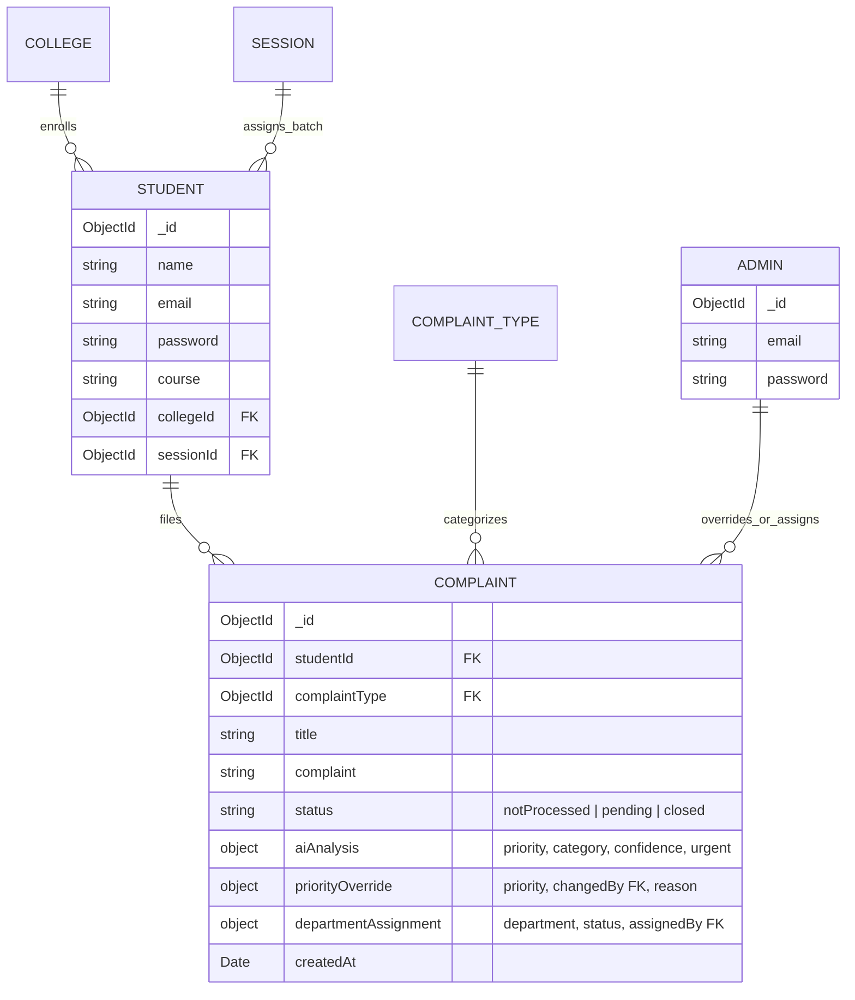

# 🍃 MongoDB & Mongoose — Complete Technical Guide & Interview Preparation

> **Project:** College Grievance Redressal System (MERN-GRS)  
> **Database Stack:** MongoDB (NoSQL Document Store), Mongoose ODM v9  
> **Reference Material:** Analyzed from `100_NodeJS_Interview_Questions_by_Pushkar_Singh.pdf` (Chapter 6) & Active GRS Model Schemas

---

## 📑 Table of Contents
1. [Core MongoDB & NoSQL Theory](#-1-core-mongodb--nosql-theory)
2. [Mongoose ODM Architecture & Features](#-2-mongoose-odm-architecture--features)
3. [How MongoDB & Mongoose are Used in MERN-GRS (Interviewer Questions & Answers)](#-3-how-mongodb--mongoose-are-used-in-mern-grs)
4. [Data Models, Schemas & Virtuals in GRS](#-4-data-models-schemas--virtuals-in-grs)
5. [Top MongoDB & Mongoose Interview Questions & Answers (English & Hinglish)](#-5-top-mongodb--mongoose-interview-questions--answers-english--hinglish)
   - [Chapter 1: NoSQL & MongoDB Fundamentals](#chapter-1-nosql--mongodb-fundamentals)
   - [Chapter 2: Mongoose Schemas, Validation & Types](#chapter-2-mongoose-schemas-validation--types)
   - [Chapter 3: Relationships, Referencing vs Embedding](#chapter-3-relationships-referencing-vs-embedding)
   - [Chapter 4: Population, Queries & Virtual Properties](#chapter-4-population-queries--virtual-properties)
   - [Chapter 5: Indexing, Performance & Optimization](#chapter-5-indexing-performance--optimization)
   - [Chapter 6: Aggregations, Transactions & Scaling](#chapter-6-aggregations-transactions--scaling)

---

## 🧠 1. Core MongoDB & NoSQL Theory

### What is MongoDB?
MongoDB is a leading open-source, document-oriented NoSQL database. Rather than storing data in rigid tables, rows, and columns like relational SQL databases, MongoDB stores records as flexible, JSON-like **BSON (Binary JSON)** documents organized into collections.

### SQL vs MongoDB (NoSQL) Comparison:
| Feature | Relational Database (SQL) | MongoDB (NoSQL) |
| :--- | :--- | :--- |
| **Data Storage** | Tables with strict rows and columns | Collections containing BSON documents |
| **Schema** | Rigid; requires `ALTER TABLE` migrations | Dynamic, polymorphic schema |
| **Relationships**| Foreign Keys & strict `JOIN`s | Document Referencing (`ObjectId`) or Nested Subdocuments |
| **Scalability** | Vertical (scale up CPU/RAM) | Horizontal (scale out via Sharding) |
| **Transactions** | ACID standard across tables | Multi-document ACID transactions supported |
| **Query Language**| Structured Query Language (SQL) | Rich JSON-based MongoDB Query Language (MQL) |

### Why BSON instead of plain JSON?
BSON supports additional data types that plain JSON lacks—most notably `ObjectId`, `Date`, `BinaryData`, and `Decimal128` (precise floating-point numbers for currency). BSON is also binary-encoded, allowing faster traversal and indexing.

---

## 🛠️ 2. Mongoose ODM Architecture & Features

### What is Mongoose?
Mongoose is an **Object Data Modeling (ODM)** library for MongoDB and Node.js. It provides a structured, schema-based solution to model application data, complete with built-in type casting, schema validation, query building, business logic hooks (middleware), and relationship population.

### Key Mongoose Capabilities:
1. **Schema Definition**: Strict typing and field constraints (`required`, `enum`, `trim`, `default`).
2. **Subdocument Embedding**: Clean nested objects like `aiAnalysis` and `priorityOverride`.
3. **Mongoose Population (`.populate()`)**: Resolves `ObjectId` references to documents in other collections (similar to a SQL `LEFT JOIN`).
4. **Virtual Getters**: Computed properties derived dynamically at runtime that are not persisted to disk.
5. **Lean Queries (`.lean()`)**: Bypasses the overhead of Mongoose Document wrapping, returning high-performance plain JavaScript objects.

---

## 🎯 3. How MongoDB & Mongoose are Used in MERN-GRS

### 🎙️ Interviewer Question:
> *"How did you design your database in the Grievance Redressal System? Why did you pick MongoDB over SQL, and how did you model the AI analysis and audit trails?"*

### 💼 Model Answer (English):
> "In MERN-GRS, we chose **MongoDB with Mongoose ODM** because grievance records in modern educational institutions require semi-structured, extensible data schemas.
>
> 1. **Backward-Compatible Schema Evolution**: When introducing AI classification, we didn't have to alter rigid relational tables. We embedded an `aiAnalysis` subdocument (`priority`, `category`, `recommendedDepartment`, `confidence`, `requiresUrgentReview`) with safe defaults. Legacy student complaints remained valid without migration errors.
> 2. **Audit Trail Modeling**: For administrative accountability, we embedded a `priorityOverride` subdocument in `Complaint.js`. Whenever an admin changes a priority, the schema records `changedBy` (Admin `ObjectId`), `changedByName`, `changedAt` (timestamp), and mandatory `reason`.
> 3. **The `effectivePriority` Virtual Property**: Rather than mutating the AI prediction when an admin overrides a priority, we defined a Mongoose virtual getter:
>    ```javascript
>    complaintSchema.virtual('effectivePriority').get(function() {
>      return this.priorityOverride?.priority || this.aiAnalysis?.priority || 'LOW';
>    });
>    ```
>    This preserves the original AI evaluation for machine learning auditing while seamlessly serving the human override to the frontend.
> 4. **Multi-Model Referencing & Population**: We decoupled our domain into 6 normalized collections: `Student`, `Complaint`, `ComplaintType`, `Admin`, `College`, and `Session`. In `complaintRoute.js`, we use chained `.populate('complaintType').populate('studentId')` to produce enriched payloads for the dashboard.
> 5. **High-Performance Aggregation**: In `/api/complaint/analytics/summary`, we use `.lean()` to stream grievances directly into statistical accumulator bins for the admin KPI dashboard without document instantiation overhead."

### 🇮🇳 Model Answer (Hinglish):
> "Humare project me **MongoDB aur Mongoose ODM** database layer ko handle karte hain.
>
> 1. **MongoDB kyu chuna SQL ke bajaye?**: Grievance Redressal me student complaint ka format dynamic ho sakta hai. MongoDB ka document model semi-structured data ke liye best hai. Jab humne AI features add kiye, toh humne complaint schema ke andar `aiAnalysis` ka subdocument add kiya bina kisi `ALTER TABLE` query ke aur bina purane data ko break kiye.
> 2. **Audit Trail aur Admin Override**: Jab koi Admin AI ki di hui priority ko badalta hai, toh hum purana AI prediction delete nahi karte. Humne schema me `priorityOverride` object banaya jisme admin ki ID, name, change karne ka time aur reason record hota hai (Full Auditability).
> 3. **Virtual Property `effectivePriority`**: Maine Mongoose ka ek virtual getter banaya. Ye check karta hai: agar admin ne priority override ki hai toh override wali priority return karo, warna AI wali priority do, aur kuch nahi hai toh 'LOW' do. Isse database me extra column store kiye bina frontend ko hamesha correct priority milti hai.
> 4. **Document Referencing & Population**: Humne 6 alag collections banayi (`Complaint`, `Student`, `Admin`, `ComplaintType`, `College`, `Session`). Inke beech relations `ObjectId` aur `ref` se banaye aur API me `.populate()` karke student aur category details ek hi query me fetch kar li.
> 5. **Fast Analytics**: Dashboard analytics ke liye humne `.lean()` use kiya jo plain JavaScript objects return karta hai jisse response time super fast ho jata hai."

---

## 🏛️ 4. Data Models, Schemas & Virtuals in GRS

### Entity-Relationship Diagram:



### Key MongoDB Files in MERN-GRS:
- [server/config/db.js](file:///c:/Users/asus/OneDrive/Desktop/MERN-GRS/server/config/db.js): Mongoose connection pool configuration with `MONGO_URI`.
- [server/model/Complaint.js](file:///c:/Users/asus/OneDrive/Desktop/MERN-GRS/server/model/Complaint.js): Main grievance schema featuring AI subdocuments, override logs, and the `effectivePriority` virtual.
- [server/model/Student.js](file:///c:/Users/asus/OneDrive/Desktop/MERN-GRS/server/model/Student.js): Student schema with encrypted password credentials and institutional references.
- [server/model/Admin.js](file:///c:/Users/asus/OneDrive/Desktop/MERN-GRS/server/model/Admin.js): Administrator credentials.

---

## ❓ 5. Top MongoDB & Mongoose Interview Questions & Answers (English & Hinglish)

### Chapter 1: NoSQL & MongoDB Fundamentals

#### Q1. What is a NoSQL database and when should you choose MongoDB over MySQL/Postgres?
- **English Answer:**  
  A NoSQL database stores non-tabular, flexible data (e.g., documents, key-value pairs, graphs). Choose MongoDB when:
  1. Your data schema evolves rapidly (e.g., adding AI tags or audit trails without schema locks).
  2. You require high write throughput and horizontal scaling (sharding).
  3. Your data naturally represents hierarchical or nested documents (e.g., complaints with nested AI scores).
  Choose SQL when strict complex multi-table joins, relational constraints, and rigid tabular accounting standards are required.
- **Hinglish Answer:**  
  NoSQL database tabular rows/columns ke bajaye flexible JSON-like documents me data store karta hai. MongoDB tab choose karte hain jab project ka schema dynamically change ho sakta ho (jaise AI metadata add karna), data nested ho, aur horizontal scaling chahiye ho. Jab rigid relations aur strict financial transactions chahiye hon tab MySQL/Postgres chuna jata hai.

#### Q2. What is BSON and why does MongoDB use it instead of JSON?
- **English Answer:**  
  BSON (Binary JSON) is a binary serialization format used to store documents in MongoDB. While JSON supports basic types (string, number, boolean, array, object, null), BSON adds support for `Date`, `ObjectId`, `Binary`, `Int64`, and `Decimal128`. BSON documents also include field length prefixes, allowing MongoDB to traverse and index documents significantly faster than parsing raw text JSON.
- **Hinglish Answer:**  
  BSON JSON ka binary version hota hai. Normal JSON me sirf text, number, array jaisi basic cheezein hoti hain. BSON me extra types hote hain jaise exact Date, ObjectId, aur Binary data. Saath hi ye binary hone ki wajah se disk par kam space leta hai aur database queries isme bohot tez search kar leti hain.

---

### Chapter 2: Mongoose Schemas, Validation & Types

#### Q3. What is a Mongoose Schema and what are SchemaTypes?
- **English Answer:**  
  A Mongoose Schema is a configuration blueprint that defines the shape, fields, validation constraints, and defaults of documents within a MongoDB collection. SchemaTypes include `String`, `Number`, `Date`, `Buffer`, `Boolean`, `Mixed`, `ObjectId`, `Array`, `Decimal128`, and `Map`.
- **Hinglish Answer:**  
  Mongoose Schema ek blueprint (naksha) hota hai jo batata hai ki database ke document me kaun-kaun se fields honge, unka data type kya hoga (String, Number, Date, ObjectId), aur kaun se fields required honge.

#### Q4. What is the difference between Schema validation and Database-level validation?
- **English Answer:**  
  - **Mongoose Schema Validation**: Happens on the Node.js application server *before* sending the write operation to MongoDB. If validation fails (e.g., missing required field, enum mismatch), Mongoose throws an error immediately, saving network roundtrips.
  - **Database Validation**: MongoDB's native JSON Schema validation enforced directly inside the database engine regardless of which client or script inserts data.
- **Hinglish Answer:**  
  Mongoose validation Node.js server par hoti hai. Database me query bhejne se pehle hi Mongoose check kar leta hai ki required fields hain ya nahi. Agar koi error hota hai toh server par hi ruk jata hai, jisse database par faltu network load nahi padta.

---

### Chapter 3: Relationships, Referencing vs Embedding

#### Q5. What is the difference between Referencing and Embedding in MongoDB?
- **English Answer:**  
  - **Embedding (Subdocuments)**: Storing related data directly inside the parent document (e.g., storing `aiAnalysis: { priority, category }` inside the `Complaint` document). Best for 1-to-1 or bounded 1-to-Few relationships where data is always retrieved together.
  - **Referencing (Normalized)**: Storing the `ObjectId` of a document from another collection (e.g., `studentId` pointing to `Student` collection). Best for 1-to-Many, Many-to-Many, or entities that grow indefinitely.
- **Hinglish Answer:**  
  - **Embedding**: Ek document ke andar hi doosra object daal dena (jaise complaint ke andar `aiAnalysis`). Isme ek hi query me poora data mil jata hai.
  - **Referencing**: Ek collection me doosre collection ki `_id` store karna (jaise complaint me `studentId`). Iska use tab karte hain jab data bada ho aur independent exist karta ho (jaise students aur complaints).

#### Q6. What is the 16MB Document Size Limit in MongoDB?
- **English Answer:**  
  The maximum BSON document size in MongoDB is **16 Megabytes**. This limit prevents single documents from consuming excessive RAM during queries and promotes efficient memory management. If an application needs to store large files (e.g., student grievance video/audio attachments exceeding 16MB), MongoDB provides **GridFS**, which chunks files into 255KB parts across two collections (`fs.files` and `fs.chunks`).
- **Hinglish Answer:**  
  MongoDB me ek single document ka maximum size 16 MB ho sakta hai taaki server ki RAM query ke waqt choke na ho. Agar 16 MB se badi files (jaise videos ya PDFs) store karni ho toh MongoDB ka **GridFS** feature use kiya jata hai jo files ko 255KB ke chunks me divide karke save karta hai.

---

### Chapter 4: Population, Queries & Virtual Properties

#### Q7. What is `.populate()` in Mongoose and how does it work?
- **English Answer:**  
  `.populate()` is Mongoose's declarative mechanism for resolving references across collections. When you call:
  ```javascript
  Complaint.find().populate('studentId', 'name email');
  ```
  Mongoose first executes the `find` on the `complaints` collection, extracts all distinct `studentId` ObjectIDs, automatically executes a second query `Student.find({ _id: { $in: ids } })`, and joins the matching student objects into the final payload before returning it to your application.
- **Hinglish Answer:**  
  Mongoose me `.populate()` SQL ke `JOIN` ki tarah kaam karta hai. Jab complaint me student ki sirf `ObjectId` hoti hai, toh `.populate('studentId')` call karne par Mongoose automatically Student collection se us student ka name, email nikal kar complaint object ke andar fit kar deta hai.

#### Q8. What is a Mongoose Virtual and why was it useful in GRS?
- **English Answer:**  
  A Virtual property is a dynamic document getter/setter that is computed at runtime and not stored in MongoDB storage.  
  In MERN-GRS, we created `effectivePriority`:
  ```javascript
  complaintSchema.virtual("effectivePriority").get(function () {
    return this.priorityOverride?.priority || this.aiAnalysis?.priority || "LOW";
  });
  ```
  This allowed our frontend to simply consume `complaint.effectivePriority` without the backend needing to write duplicate priority fields to the database every time an administrator performed an override.
- **Hinglish Answer:**  
  Virtuals aise properties hote hain jo database me disk par save nahi hote, balki code run hone par dynamically calculate hote hain. GRS me humne `effectivePriority` virtual banaya jo dekhta hai ki agar admin ne override kiya hai toh wo priority de, warna AI ki priority de. Isse database me redundant data save nahi karna pada.

#### Q9. Why should you use `.lean()` in read-heavy queries?
- **English Answer:**  
  By default, Mongoose wraps query results in rich Mongoose Document instances with change tracking, getters, setters, and internal methods (`save()`, `validate()`). This adds significant CPU and memory overhead. Calling `.lean()` instructs Mongoose to skip document instantiation and return plain JavaScript objects (POJOs), speeding up read operations by 3x–5x and reducing memory consumption.
- **Hinglish Answer:**  
  Normal query me Mongoose har record ko ek heavy class object me wrap karta hai jisme functions aur change-tracking hoti hai. Agar hume sirf data read karke frontend ko bhejna hai, toh `.lean()` lagane se Mongoose plain JS object return karta hai, jisse memory bachti hai aur query 4 guna fast ho jaati hai.

---

### Chapter 5: Indexing, Performance & Optimization

#### Q10. What is Indexing in MongoDB and what are the trade-offs?
- **English Answer:**  
  An index is a specialized B-tree data structure that stores a small portion of the collection's data set in an easily traversable form. Without indexes, MongoDB must perform a **Collection Scan (`COLLSCAN`)**, examining every document in the collection to satisfy a query. Indexes allow **Index Scans (`IXSCAN`)**, drastically reducing query latency.  
  **Trade-offs**: Indexes consume disk space and slightly slow down write operations (INSERT, UPDATE, DELETE) because every index must be updated upon document mutation.
- **Hinglish Answer:**  
  Index kitaab ke aakhri page par diye index ki tarah hota hai. Bina index ke MongoDB ko poori collection ke har document ko scan karna padta hai (`COLLSCAN`) jisme bohot time lagta hai. Index lagane se query direct data dhoondh leti hai (`IXSCAN`). Trade-off ye hai ki indexes disk space lete hain aur write/insert queries thodi si slow ho jaati hain.

---

### Chapter 6: Aggregations, Transactions & Scaling

#### Q11. What is the MongoDB Aggregation Pipeline?
- **English Answer:**  
  The Aggregation Pipeline is a framework for advanced data processing and transformation modeled on the concept of data processing pipelines. Documents enter a multi-stage pipeline where each stage transforms the documents (e.g., filtering with `$match`, grouping and computing sums/averages with `$group`, restructuring fields with `$project`, and sorting with `$sort`).
- **Hinglish Answer:**  
  Aggregation Pipeline ek assembly line ki tarah hoti hai jahan data stage-by-stage process hota hai. Pehli stage me filter kiya (`$match`), doosri stage me category-wise count nikala (`$group`), teesri stage me fields reshape kiye (`$project`), aur aakhri stage me sort kiya (`$sort`). Ye complex reports aur analytics nikalne ke kaam aati hai.

---

## 📌 Summary Checklist for MongoDB Interview

| Concept | Quick Memory Trigger | GRS Project Reference |
| :--- | :--- | :--- |
| **Document Store** | Flexible BSON documents in collections | `Complaint.js`, `Student.js` |
| **Subdocuments** | Nested objects for cohesive data | `aiAnalysis`, `priorityOverride` |
| **Virtual Property** | Computed runtime attribute (no DB write) | `effectivePriority` in `Complaint.js` |
| **Population** | MQL join across collections | `.populate('complaintType')` |
| **Lean Queries** | High-speed plain JS objects | Used in `/analytics/summary` route |
| **Audit Log** | Admin ID, name, date, and override reason | Recorded in `priorityOverride` object |
