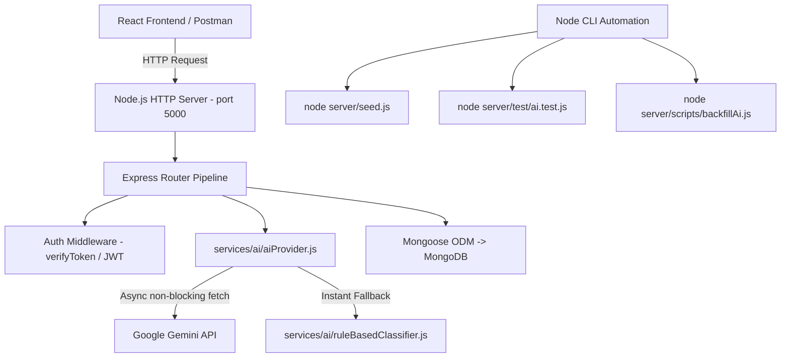

# 🟢 Node.js — Complete Technical Guide & Interview Preparation

> **Project:** College Grievance Redressal System (MERN-GRS)  
> **Backend Runtime:** Node.js (v18 / v24+), CommonJS Module Architecture  
> **Reference Material:** Analyzed from `100_NodeJS_Interview_Questions_by_Pushkar_Singh.pdf` & Active GRS Server Codebase

---

## 📑 Table of Contents
1. [Core Node.js Theory & Architecture](#-1-core-nodejs-theory--architecture)
2. [The Node.js Event Loop & Concurrency Model](#-2-the-nodejs-event-loop--concurrency-model)
3. [How Node.js is Used in MERN-GRS (Interviewer Questions & Answers)](#-3-how-nodejs-is-used-in-mern-grs)
4. [GRS Backend Execution Flow & Script Architecture](#-4-grs-backend-execution-flow--script-architecture)
5. [Top Node.js Interview Questions & Answers (English & Hinglish)](#-5-top-nodejs-interview-questions--answers-english--hinglish)
   - [Chapter 1: Node.js Basics & Runtime Architecture](#chapter-1-nodejs-basics--runtime-architecture)
   - [Chapter 2: Modules, npm & Module Resolution](#chapter-2-modules-npm--module-resolution)
   - [Chapter 3: Core Modules (fs, path, http, events, process)](#chapter-3-core-modules)
   - [Chapter 4: Asynchronous Programming & Event Loop](#chapter-4-asynchronous-programming--event-loop)
   - [Chapter 5: Streams, Buffers & Memory Optimization](#chapter-5-streams-buffers--memory-optimization)
   - [Chapter 6: Error Handling & Process Resilience](#chapter-6-error-handling--process-resilience)
   - [Chapter 7: Clustering, Scaling & Multi-threading](#chapter-7-clustering-scaling--multi-threading)
   - [Chapter 8: Native Testing & Scripting in GRS](#chapter-8-native-testing--scripting-in-grs)

---

## 🧠 1. Core Node.js Theory & Architecture

### What is Node.js?
Node.js is an open-source, cross-platform JavaScript runtime environment built on Google Chrome's **V8 JavaScript Engine**. It executes JavaScript code outside a browser, enabling developers to build fast, scalable server-side networking applications.

### Key Architectural Pillars:
1. **Google V8 Engine**: Compiles JavaScript directly into native machine code using Just-In-Time (JIT) compilation for blazing speed.
2. **Single-Threaded Event Loop**: Node.js executes JavaScript code on a single thread, avoiding the overhead of thread context switching and thread synchronization locks.
3. **Non-Blocking Asynchronous I/O**: Instead of waiting for database reads, file systems, or network requests to complete, Node delegates I/O operations to the operating system or its internal thread pool and continues processing subsequent requests.
4. **Libuv C Library**: The underlying multi-platform C library that handles:
   - The Event Loop.
   - Asynchronous I/O polling (using epoll on Linux, kqueue on macOS, and IOCP on Windows).
   - A thread pool (default 4 threads) used for heavy blocking operations (file system calls, DNS lookups, crypto hashing).

---

## 🔄 2. The Node.js Event Loop & Concurrency Model

```
   ┌───────────────────────────┐
┌─>│           timers          │ <--- setTimeout(), setInterval()
│  └─────────────┬─────────────┘
│  ┌─────────────┴─────────────┐
│  │     pending callbacks     │ <--- I/O callbacks deferred to the next loop iteration
│  └─────────────┬─────────────┘
│  ┌─────────────┴─────────────┐
│  │       idle, prepare       │ <--- internal libuv use only
│  └─────────────┬─────────────┘
│  ┌─────────────┴─────────────┐
│  │           poll            │ <--- retrieve new I/O events; execute I/O callbacks
│  └─────────────┬─────────────┘
│  ┌─────────────┴─────────────┐
│  │           check           │ <--- setImmediate() callbacks run here
│  └─────────────┬─────────────┘
│  ┌─────────────┴─────────────┐
└──┤      close callbacks      │ <--- socket.on('close', ...)
   └───────────────────────────┘
```

### Microtasks vs Macrotasks:
- **Microtask Queue**: Holds `process.nextTick()` and resolved `Promise` callbacks (`.then()`, `await`).
  - **Rule**: Microtasks are executed *immediately* after the current operation completes, before the event loop advances to the next phase!
  - `process.nextTick()` has higher priority over Promise microtasks.
- **Macrotask Queue**: Timers (`setTimeout`, `setInterval`), `setImmediate`, I/O callbacks.

---

## 🎯 3. How Node.js is Used in MERN-GRS

### 🎙️ Interviewer Question:
> *"How did you use Node.js in your Grievance Redressal System project? What role does it play in the architecture, and how does it handle asynchronous operations?"*

### 💼 Model Answer (English):
> "In MERN-GRS, Node.js serves as our core server runtime hosting our Express.js REST API.
>
> 1. **Asynchronous Non-Blocking API Orchestration**: When a student submits a grievance, the server needs to record the complaint, call external AI LLMs (Gemini / OpenAI), and compute fallback rules. Because Node.js is non-blocking, we use native `fetch` with `AbortController` timeouts (12-second ceiling) inside `server/services/ai/aiProvider.js`. Even if external AI APIs experience latency, the Node event loop is never blocked, allowing other students to log in or browse tickets simultaneously.
> 2. **Process & Configuration Management**: We leverage Node's `process` global object and `dotenv` to safely inject secrets (`JWT_SECRET`, `MONGO_URI`, `GEMINI_API_KEY`, `PORT`) outside the source code.
> 3. **Database Seeding & Migration Scripts**: I developed standalone Node.js automation scripts:
>    - `server/seed.js`: An idempotent script that connects to MongoDB, cleans collections, and seeds colleges, admins, complaint categories, and demo students using asynchronous Promise chains.
>    - `server/scripts/backfillAi.js`: A background data migration utility that retrofits legacy grievances with AI classification tags without corrupting existing student data.
> 4. **Automated Testing**: We utilized Node's native test runner (`node server/test/ai.test.js`) to assert category classification, priority tagging, and fallback behaviors without needing heavy third-party testing dependencies."

### 🇮🇳 Model Answer (Hinglish):
> "Humare project me **Node.js** backend ka foundation runtime hai jispe poora Express server run hota hai.
>
> 1. **Non-Blocking Asynchronous Operations**: Jab koi student complaint lodge karta hai, toh backend ko AI API (Google Gemini ya OpenAI) ko call karna hota hai. Node.js ke non-blocking I/O aur `async/await` ki wajah se humara server freeze nahi hota. Humne `AbortController` ke through 12-second ka timeout lagaya hai taaki agar AI API slow bhi ho, toh baaki students ke login aur complaints smoothly chalte rahein.
> 2. **Environment & Process Management**: Sensitive credentials jaise `MONGO_URI`, `JWT_SECRET`, aur `GEMINI_API_KEY` ko manage karne ke liye Node ke `process.env` aur `dotenv` package ka use kiya hai.
> 3. **Automation & Seeding Scripts**: Maine Node.js me scripts banayi hain jaise `seed.js` jo command line se single command me database ke andar colleges, admin accounts aur default complaint categories create kar deta hai. Saath hi `backfillAi.js` script se purane records par AI metadata migrate kiya.
> 4. **Automated Testing**: Node ke built-in test runner se `server/test/ai.test.js` banaya jo verify karta hai ki severe ragging ya harassment ki complaints High Priority me classify ho rahi hain ya nahi."

---

## 🏛️ 4. GRS Backend Execution Flow & Script Architecture



### Key Node.js Files in MERN-GRS:
- [server/index.js](file:///c:/Users/asus/OneDrive/Desktop/MERN-GRS/server/index.js): Application bootstrap, environment config, and HTTP listener.
- [server/seed.js](file:///c:/Users/asus/OneDrive/Desktop/MERN-GRS/server/seed.js): Standalone database seed script utilizing Node async/await.
- [server/services/ai/aiProvider.js](file:///c:/Users/asus/OneDrive/Desktop/MERN-GRS/server/services/ai/aiProvider.js): Non-blocking HTTP integration with Gemini/OpenAI using native `fetch` and `AbortController`.
- [server/test/ai.test.js](file:///c:/Users/asus/OneDrive/Desktop/MERN-GRS/server/test/ai.test.js): Automated Node native assertion suite.

---

## ❓ 5. Top Node.js Interview Questions & Answers (English & Hinglish)

### Chapter 1: Node.js Basics & Runtime Architecture

#### Q1. What is Node.js and why is it preferred for I/O heavy web applications?
- **English Answer:**  
  Node.js is a server-side JavaScript runtime built on Chrome’s V8 engine. It uses an event-driven, non-blocking I/O model that makes it lightweight and efficient. For I/O-heavy applications (like chat apps, streaming platforms, and REST APIs), Node handles tens of thousands of concurrent connections on a single thread without thread starvation or high memory consumption.
- **Hinglish Answer:**  
  Node.js ek runtime environment hai jo JavaScript ko browser ke bahar server par chalata hai. Ye I/O-heavy applications ke liye best hai kyunki ye non-blocking I/O use karta hai. Har request ke liye naya thread banane ke bajaye ye single thread par asynchronous tarike se hazaron requests bina wait kiye handle kar leta hai.

#### Q2. How is Node.js single-threaded yet capable of handling concurrent tasks?
- **English Answer:**  
  Node.js executes user JavaScript code on a **single main thread**. However, all asynchronous I/O operations (file system, network calls, crypto hashing) are delegated to the underlying operating system kernel or the **libuv thread pool**. Once an operation completes, libuv pushes the callback to the event loop queue to be executed on the main thread.
- **Hinglish Answer:**  
  Node.js ka JavaScript code ek hi main thread par chalta hai, lekin background me Libuv library ka multi-threaded C++ thread pool kaam karta hai. Jab koi heavy kaam aata hai (jaise database query ya file read), Node us kaam ko background threads ko de deta hai aur main thread free rehta hai agli request lene ke liye. Kaam complete hone par callback queue me daal diya jata hai.

#### Q3. What is the difference between synchronous and asynchronous code in Node.js?
- **English Answer:**  
  Synchronous code blocks the execution thread until the current operation finishes (e.g., `fs.readFileSync`), preventing any other request from being served. Asynchronous code (e.g., `fs.readFile` or `await fetch()`) starts the task in the background and immediately frees the thread, executing the callback when the task completes.
- **Hinglish Answer:**  
  Synchronous code thread ko block kar deta hai—jab tak wo line khatam nahi hoti, agla code execute nahi ho sakta. Asynchronous code task ko background me trigger kar deta hai aur aage badh jata hai, aur jab result aata hai tab callback ya Promise ke through response bhejta hai.

---

### Chapter 2: Modules, npm & Module Resolution

#### Q4. What is the difference between CommonJS and ES Modules (ESM)?
- **English Answer:**  
  - **CommonJS (CJS)**: The traditional Node.js module system. Uses `require()` for synchronous imports and `module.exports` for exports. Loaded at runtime. Default in Node.js.
  - **ES Modules (ESM)**: Modern JavaScript standard. Uses `import` and `export`. Evaluated statically at compile/parse time. Enabled by setting `"type": "module"` in `package.json` or using `.mjs` file extension.
- **Hinglish Answer:**  
  - **CommonJS**: Node ka purana aur default system hai. Isme `require()` aur `module.exports` use hota hai, aur ye runtime par synchronously load hota hai.
  - **ES Modules**: Modern JavaScript standard hai. Isme `import` aur `export` use hota hai aur ye parse time par statically load hota hai. Isko use karne ke liye `package.json` me `"type": "module"` likhna padta hai.

#### Q5. What is the difference between `package.json` and `package-lock.json`?
- **English Answer:**  
  `package.json` contains metadata about the project, scripts, and high-level dependency ranges (e.g., `^18.2.0` which allows minor updates). `package-lock.json` records the exact resolved version, integrity hash, and nested dependency tree for every installed package, guaranteeing identical installation across different machines and deployment environments.
- **Hinglish Answer:**  
  `package.json` me project ki details aur version range likhi hoti hai (jaise `^5.0.0`). Jabki `package-lock.json` me har package ka exact version aur dependency tree lock hota hai taaki kisi aur computer ya production server par `npm install` chalane par version mismatch ki wajah se app crash na ho.

#### Q6. What is the difference between `dependencies` and `devDependencies`?
- **English Answer:**  
  `dependencies` are modules strictly required for the application to function in production (e.g., `express`, `mongoose`, `jsonwebtoken`). `devDependencies` are packages needed only during local development and testing (e.g., `nodemon`, `eslint`, test frameworks). In production (`npm install --production`), devDependencies are skipped to save disk space and build time.
- **Hinglish Answer:**  
  `dependencies` wo packages hain jinke bina app production me chal hi nahi sakti (jaise `express`, `bcrypt`). `devDependencies` sirf developer ke local testing aur development ke kaam aate hain (jaise `nodemon`, linters) aur production deployment me install nahi hote.

---

### Chapter 3: Core Modules

#### Q7. What is `process.nextTick()` and how does it differ from `setImmediate()`?
- **English Answer:**  
  - `process.nextTick()`: Schedules a callback to be executed in the **Microtask Queue** right after the current operation completes, before the event loop advances to the next phase.
  - `setImmediate()`: Schedules a callback to run in the **Check Phase** of the macrotask event loop cycle (after the poll phase).
  - Therefore, `process.nextTick()` always fires before `setImmediate()`.
- **Hinglish Answer:**  
  `process.nextTick()` microtask queue me jata hai aur current line of code execute hote hi agle loop phase se pehle turant run ho jata hai. Jabki `setImmediate()` Event Loop ke 'Check' phase me agle round me chalta hai. Isliye `process.nextTick()` hamesha `setImmediate()` se pehle execute hota hai.

#### Q8. What is the `path` module and why should we use `path.join()` instead of string concatenation?
- **English Answer:**  
  The `path` module provides cross-platform utilities for handling file paths. Different operating systems use different path separators (`\` on Windows vs `/` on POSIX/Linux). Using `path.join('/folder', 'file.txt')` automatically resolves the correct operating system delimiter and normalizes double slashes and relative segments (`..`).
- **Hinglish Answer:**  
  Windows me path me backslash `\` use hota hai aur Linux/Mac me forward slash `/`. Agar hum direct string concatenation (`folder + '/' + file`) karenge toh cross-platform bugs aayenge. `path.join()` operating system ke hisab se sahi slash laga kar safe path banata hai.

#### Q9. What is `EventEmitter` in Node.js?
- **English Answer:**  
  `EventEmitter` is a class from the `events` core module that facilitates event-driven programming. Objects can emit named events using `.emit('eventName', data)` and register one or more listener functions using `.on('eventName', callback)`. It is the foundational pattern underlying Node's HTTP servers, streams, and socket architectures.
- **Hinglish Answer:**  
  `EventEmitter` Node.js ka Pub/Sub pattern implement karta hai. Ek jagah se hum event trigger (emit) karte hain `emitter.emit('userRegistered')`, aur dusri jagah par listener `emitter.on('userRegistered', callback)` us event ko pakad kar logic execute karta hai.

---

### Chapter 4: Asynchronous Programming & Event Loop

#### Q10. What is Callback Hell and how does `async/await` solve it?
- **English Answer:**  
  Callback Hell (Pyramid of Doom) happens when multiple asynchronous operations are deeply nested inside callbacks, resulting in unreadable, brittle code with fragmented error handling. Promises flatten these trees into `.then().catch()` chains, and `async/await` allows asynchronous code to be written synchronously using familiar `try...catch` blocks.
- **Hinglish Answer:**  
  Jab ek asynchronous callback ke andar dusra callback, aur uske andar teesra callback nest karte hain, toh code pyramid jaisa ban jata hai jise 'Callback Hell' bolte hain. Isko debug aur maintain karna bohot mushkil hota hai. `async/await` se asynchronous code simple step-by-step readable code ban jata hai aur hum standard `try...catch` se errors handle kar sakte hain.

#### Q11. What is the difference between `Promise.all()`, `Promise.allSettled()`, and `Promise.race()`?
- **English Answer:**  
  - `Promise.all([p1, p2])`: Runs promises concurrently. Resolves when all succeed; rejects immediately if *any single* promise rejects (fail-fast).
  - `Promise.allSettled([p1, p2])`: Waits for all promises to finish regardless of whether they fulfilled or rejected, returning an array of outcome objects `{ status, value | reason }`.
  - `Promise.race([p1, p2])`: Resolves or rejects as soon as the *first* promise settles.
- **Hinglish Answer:**  
  - `Promise.all`: Saare promises ke complete hone ka wait karta hai. Agar ek bhi fail hua toh poora fail ho jata hai.
  - `Promise.allSettled`: Saare promises complete hone ka wait karta hai chahe wo pass ho ya fail, aur sabka result detail deta hai.
  - `Promise.race`: Jo promise sabse pehle finish ho jata hai (chahe pass ho ya fail), uska result turant return kar deta hai.

---

### Chapter 5: Streams, Buffers & Memory Optimization

#### Q12. What are Streams and why are they superior to reading an entire file with `fs.readFile()`?
- **English Answer:**  
  A stream is an interface for reading or writing data continuously in small chunks rather than loading the entire payload into RAM at once. If you load a 2GB file using `fs.readFile()`, Node will allocate 2GB of buffer memory, easily exceeding the V8 memory ceiling (~1.4GB) and crashing the process. With `fs.createReadStream()`, the file is processed chunk-by-chunk in small 64KB buffers, maintaining near-zero memory footprint.
- **Hinglish Answer:**  
  Streams data ko chhote-chhote tukdon (chunks) me process karte hain. Agar 2GB ki file ko direct `fs.readFile` se read karoge toh server ki RAM full ho jayegi aur app crash ho jayegi. Streams us file ko 64KB ke packets me read karke pipe kar deta hai, jisse memory bilkul waste nahi hoti aur speed fast rehti hai.

#### Q13. What is Backpressure in Node.js streams?
- **English Answer:**  
  Backpressure occurs when the data-producing stream (Readable) pushes data faster than the consuming stream (Writable) can write it to the destination (e.g., fast disk reading vs slow network pipe). Node automatically handles this when using `.pipe()` by pausing the readable stream when the writable internal buffer fills up and resuming when the buffer drains (`drain` event).
- **Hinglish Answer:**  
  Backpressure tab hota hai jab data aane ki speed (Readable) data likhne ya process karne ki speed (Writable) se bohot zyada ho. Node.js ke `.pipe()` method me backpressure handling built-in hoti hai—wo readable stream ko pause kar deta hai jab tak writable buffer khali na ho jaye.

---

### Chapter 6: Error Handling & Process Resilience

#### Q14. What are Uncaught Exceptions and Unhandled Promise Rejections? How should they be handled?
- **English Answer:**  
  - `uncaughtException`: A synchronous error that was not caught in any `try...catch` block.
  - `unhandledRejection`: An asynchronous promise that was rejected without a `.catch()` handler.
  If left unhandled, they cause unexpected state corruption. In production, we listen to:
  ```javascript
  process.on('unhandledRejection', (reason, promise) => { ... });
  process.on('uncaughtException', (error) => {
    logger.error('Fatal crash:', error);
    process.exit(1); // Exit and let process manager (PM2/Docker) restart cleanly
  });
  ```
- **Hinglish Answer:**  
  Agar kisi error ko `try...catch` ya `.catch()` se handle na kiya jaye, toh wo application ko crash kar sakta hai. Isko handle karne ke liye hum `process.on('unhandledRejection')` aur `process.on('uncaughtException')` listeners lagate hain taaki error log ho sake aur PM2 ya Docker process ko restart kar sake.

#### Q15. How do you distinguish between Operational Errors and Programmer Errors?
- **English Answer:**  
  - **Operational Errors**: Predictable runtime situations that are part of normal operation, such as database connection timeouts, invalid user inputs, or external API rate limits. These should be caught, handled gracefully, and communicated via proper HTTP status codes (`400`, `404`, `503`).
  - **Programmer Errors**: Actual bugs in code (e.g., trying to read property of `undefined`, syntax errors, passing wrong arguments). These must be debugged and fixed by developers.
- **Hinglish Answer:**  
  - **Operational Errors**: Expected runtime issues hote hain jo normal use me aa sakte hain (jaise user ne galat password daala ya internet chala gaya). Inhe `try...catch` se handle karke user ko clean message dikhana chahiye.
  - **Programmer Errors**: Code ke bugs hote hain (jaise `undefined.map()`). Inhe try-catch se chupana nahi chahiye balki code theek karna chahiye.

---

### Chapter 7: Clustering, Scaling & Multi-threading

#### Q16. What is the Node.js Cluster Module and PM2?
- **English Answer:**  
  Because Node.js runs on a single CPU core, multi-core servers remain underutilized by default. The `cluster` module uses the OS fork system to spawn multiple worker processes that share the same server port. **PM2** is an enterprise-grade production process manager that automates clustering (`pm2 start server.js -i max`), zero-downtime reloads, and automatic crash recovery.
- **Hinglish Answer:**  
  Kyunki Node.js ek hi CPU core use karta hai, 8-core CPU wale server par 7 cores khali pade rehte hain. `cluster` module ya **PM2** har CPU core ke liye ek worker process start kar dete hain aur load distribute karte hain, jisse traffic handling capacity 8 guna badh jaati hai.

---

### Chapter 8: Native Testing & Scripting in GRS

#### Q17. How did you test your AI integration in Node.js?
- **English Answer:**  
  In `server/test/ai.test.js`, we leveraged Node's native test runner to validate rule-based fallback and classification logic:
  ```javascript
  // Asserts urgent ragging/harassment triggers High Priority
  const result = classifyWithRules("Senior students are physically threatening juniors in hostel block A");
  assert.strictEqual(result.priority, "HIGH");
  assert.strictEqual(result.requiresUrgentReview, true);
  ```
  This allowed us to achieve full test coverage without bloating our production dependencies with third-party frameworks.
- **Hinglish Answer:**  
  Maine `server/test/ai.test.js` me automated tests likhe jo verify karte hain ki:
  1. Ragging ya physical safety ki complaints automatically **HIGH** priority me ja rahi hain.
  2. Admit card ya fee issues **MEDIUM** priority me classify ho rahe hain.
  3. External API down hone par rule-based fallback crash huye bina response return kar raha hai.

---

## 📌 Summary Checklist for Node.js Interview

| Concept | Quick Memory Trigger | GRS Project Reference |
| :--- | :--- | :--- |
| **V8 Engine** | JIT compiles JS to Machine Code | Server execution engine |
| **Libuv** | Handles Event Loop & 4-thread pool | Background crypto & I/O operations |
| **Microtask Priority** | `nextTick` > Promise > Timers | Clean async/await order in controllers |
| **AbortController** | 12s timeout ceiling on AI calls | `server/services/ai/aiProvider.js` |
| **Seed Scripting** | Standalone Node async automation | `server/seed.js` for DB initialization |
| **Environment Config** | `dotenv` & `process.env` security | Hiding JWT secrets and database URLs |
